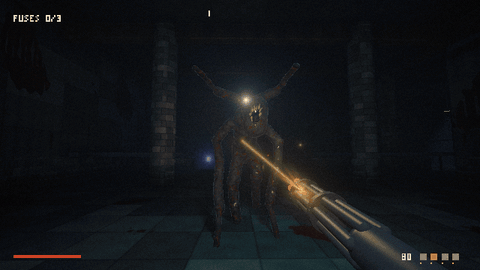

# Kilocrypt

A first-person horror shooter in under 16 KB, for Linux and Windows: the smallest native true-3D first-person shooter we know of (as of 2026). The smallest native true-3D ones we found before it are shooter32k (31,232 bytes) and nervk (about 32 KB); DEADWEIGHT (15,132 bytes) is smaller but a 2.5D raycaster.



Six floors, each a 4×4 grid of cells joined by arched doorways and merged into halls and L-shaped rooms: crypts, storerooms, meat lockers, boiler rooms and catwalks. The power is out. Find the three fuses on each floor; every fuse turns more lamps back on, and all three power the exit. Monsters keep crawling out of the dark rooms: crawler swarms, screamers that run at you and explode, tentacle masses that spit from range and brutes that charge. Each floor bends one rule: alarms kill the lights, crawlers drop from the ceiling, a brute that cannot die before the third fuse hunts you, the power stays dead. Floor six is a boss that only fuses can weaken. Beat it and the run starts again, harder, with more monsters awake and the rules in a new order.

| Build | Size |
|---|---|
| `build/kilocrypt.exe` (Windows, 16 KB packed) | 16384 bytes |
| `build/kilocrypt` (Linux, 16 KB packed) | 16057 bytes |
| `build/kilocrypt-unpacked.exe` (Windows 64-bit, unpacked) | 202752 bytes |

## Play

Download `kilocrypt.exe` (Windows, 16 KB), `kilocrypt-unpacked.exe` (Windows 64-bit, unpacked for fewer antivirus false positives) or `kilocrypt` (Linux) from the [releases page](https://github.com/Mouhand-Kaddo/kilocrypt/releases) and run it. It opens fullscreen at your desktop resolution. On Linux, run `chmod +x kilocrypt` first.

## Controls

| Input | Action |
|---|---|
| Mouse | Look |
| WASD | Move |
| Space | Jump |
| Shift | Dash |
| Left click | Fire |
| Right click | Alt fire, once the gun has its first upgrade: both shotgun barrels, minigun overdrive, a fan of three rockets, a plasma shockwave that hurts, throws back and stuns every monster around you |
| 1–4 | Shotgun, minigun, rocket launcher, plasma rifle |
| Mouse wheel | Next or previous gun |
| Esc | Pause and release the mouse (also pauses when the window loses focus); click to resume. Esc again quits, unless the pause came from losing focus |
| Alt+F4 | Quit |

The shotgun never runs out. The other guns use ammo from crates and dead monsters. Monsters guarding the fuses carry the loot: on floors 2–4 the first one you kill drops the next gun (a gun lost by dying turns up again on a later floor), and the last one drops the floor's upgrade. Each gun takes two upgrades: the first unlocks its alt fire, the second doubles the shotgun's pellets and reach, removes the minigun's spin-up, doubles rocket blasts or doubles the plasma rifle's fire rate and shockwave rate. Each upgrade also raises that gun's ammo capacity by half. Upgrades go to the gun in your hands, or to the least upgraded gun once it is full. Each fuse heals you and sets off an alarm that sends nearby monsters after you. Gibs restore a little health, and each floor hides one green medkit off the compass line. After death, click to restart the floor with the weapons, ammo and upgrades you had when you entered it.

## Requirements

- OpenGL 4.3 GPU. Without one the game shows "Needs OpenGL 4.3" and quits.
- Windows: a CPU with SSE4.2.
- Linux: x86-64 and SDL2 (or `sdl2-compat`).

## Antivirus warnings

The 16 KB Windows exe (`kilocrypt.exe`) is compressed with Crinkler, the packer most tiny demos use. Some malware uses packers too, so a few antivirus tools flag any packed file they don't recognise. Microsoft Defender, Avast, AVG, Bitdefender, ESET, Kaspersky, Norton, McAfee, Google and Malwarebytes pass it; 8 of 69 engines on [VirusTotal](https://www.virustotal.com/gui/file/580e24a90bf7cce3f00e8918d5c6d6d80d754acac987fc31edf1e891a95eedd2) flag it.

If you'd rather avoid a packed executable, download `kilocrypt-unpacked.exe` instead — a standard 64-bit Windows build compiled with MSVC without any packer (1 of 68 engines on [VirusTotal](https://www.virustotal.com/gui/file/c9bbe6aafba4575582ab18c7f629c803f6995563db5e9b5ceaab0eb41f551be8); Microsoft Defender, Google, ESET, Bitdefender, Kaspersky, Avast, AVG, Norton, McAfee and Malwarebytes all pass it). The Linux build passes [0 of 64](https://www.virustotal.com/gui/file/baa23ae87171e860d28bf1781e4edcbc687516e1c127b4ce2e1bbb4510d2fec5). Every byte is built from the source in this repository, and the release page lists SHA-256 checksums.

## Building

Needs `clang`, `python3`, `glslangValidator` and SDL2 headers. Packed Windows builds also need `llvm-dlltool` and `wine`; `make` downloads Crinkler 3.0b and checks its checksum. Unpacked 64-bit Windows builds use `mingw-w64-gcc` locally or MSVC (`cl.exe` / `.github/workflows/build-unpacked.yml`) on Windows.

```sh
make linux            # build/kilocrypt
make windows          # build/kilocrypt.exe
make windows-unpacked # build/kilocrypt-unpacked.exe (MinGW-w64)
make dev              # unpacked Linux debug build with a bot player
```

`build/dev-game` runs a scripted bot in a 960×540 window. `FRAMES`, `DUMP=n` (save a PPM every n frames into `build/dev/`), `LEVEL` and `DEFINES` control it. Extra defines: `SHOWCASE` (monster line-up), `STAND`, `SOUNDTEST` (every sound, then the music from calm to full combat), `ENDING` and `RESPAWN`. Without a window, `tools/linux-test/shot.sh` renders the same modes headlessly, and `make check` runs full packs plus the bot scenarios in `tools/linux-test/scenarios.py`.

```sh
FRAMES=900 DUMP=150 ./build/dev-game
python3 tools/ppm2png.py build/dev/*.ppm
```

## Layout

- `src/game.glsl`: the whole game. `#ifdef GAME` is a compute shader (physics, monster AI and pathfinding, level generation, weapons, pickups, particles, synth and music); the rest is the full-screen fragment renderer (ray-traced rooms, ray-marched monsters, pixel-font HUD). Both share one storage buffer.
- `src/linux.c`, `src/windows.c`, `src/windows_unpacked.c`: platform layers that pass input in, dispatch the compute shader, play its audio and draw one rectangle.
- `tools/`: shader minifier, shader header generator, Linux ELF packer and its decoder stub, Crinkler fetch script, Windows import definitions and resources.
